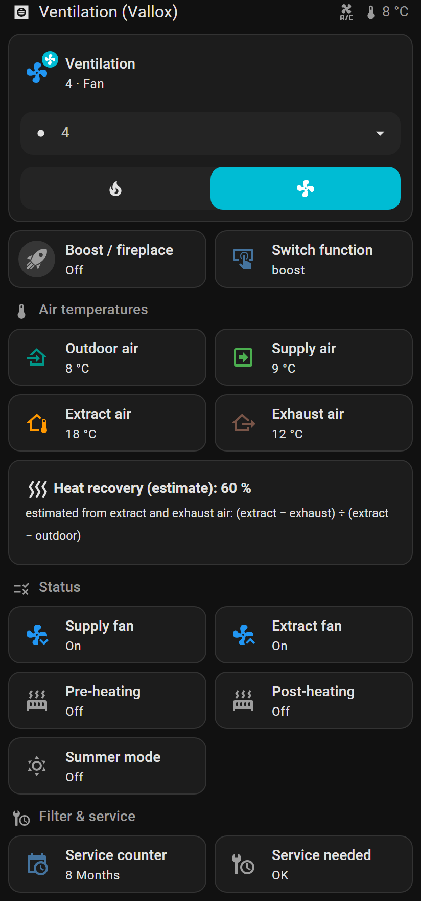
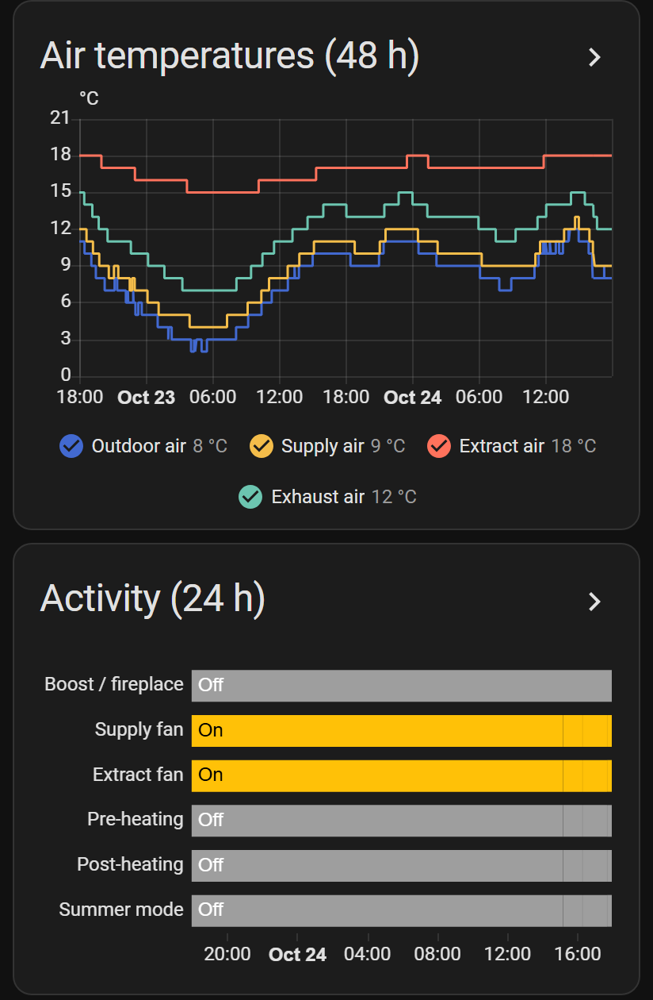
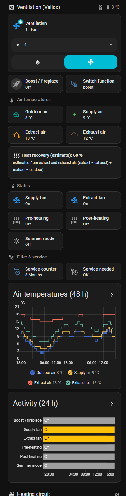
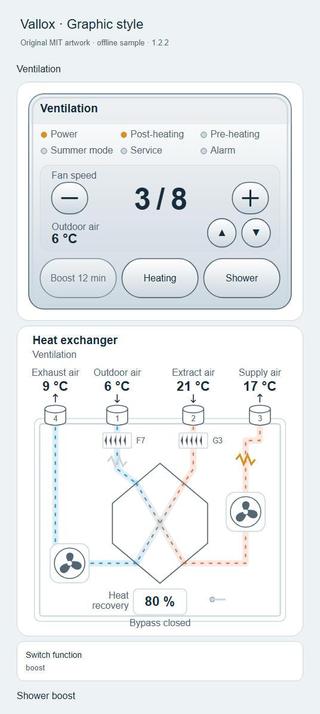
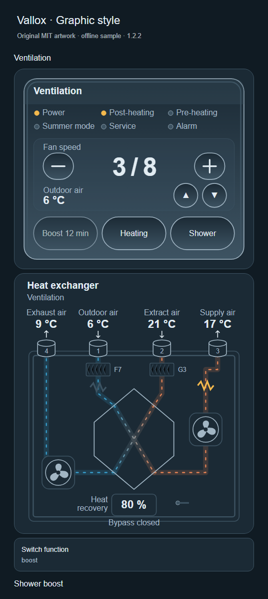

# Vallox Dashboard for Home Assistant

[](https://hacs.xyz/)
[](https://github.com/silviuk/vallox-dashboard/releases)
[](https://github.com/silviuk/vallox-dashboard/actions/workflows/validate.yml)

A Lovelace UI for **Vallox ventilation units** (MVHR / heat-recovery ventilation). Current release: **1.2.1**.

It ships as **section, view and dashboard strategies** under `custom:vallox-ventilation`. The UI discovers your entities and skips anything missing or disabled, so there is nothing you have to wire up by hand. The default style uses built-in Home Assistant cards (tile, heading, button, history-graph, markdown). An opt-in graphic style adds one bundled custom card with original inline SVG artwork.

Supported integrations (auto-discovered):

| Integration | Units | Notes |
|---|---|---|
| [vallox2mqtt](https://github.com/kotope/valloxesp) (ESP8266/ESP32 over RS485) | Vallox Digit SE, ValloPlus SE, and other RS485 models | climate fan modes 1–8, boost/fireplace switch, heating/motor status, service counter |
| [Vallox](https://www.home-assistant.io/integrations/vallox/) (Home Assistant core) | Vallox MV series (network) | fan with profiles, efficiency, fan RPMs, filter date, supply-air targets, bypass lock |

| Overview (mobile) | History (mobile) | Section (desktop column) |
|---|---|---|
|  |  |  |

*Screenshots above are from a real Vallox Digit SE running vallox2mqtt (tiles style).*

## What you get

- **Controls:** fan speed (vallox2mqtt modes 1–8, or core profiles and fan speed), heating mode, and the boost/fireplace switch.
- **Air temperatures:** outdoor, supply, extract and exhaust, with colour-coded icons.
- **Heat recovery:** the unit's efficiency sensor when present; otherwise a guarded estimate `(extract − exhaust) ÷ (extract − outdoor)`, shown only when extract minus outdoor is at least **4 K**, clamped to 0–100%.
- **Indoor air:** humidity and CO₂ when the unit exposes those sensors and they are enabled.
- **Status:** supply and extract fan, pre- and post-heating, summer mode, bypass, cell state.
- **Filter & service:** service counter or filter date, plus a warning when service is due.
- **History:** air temperatures (48 h), indoor air (24 h) and an activity timeline (24 h).
- **vallox2mqtt 1.2 extras (plugin 1.1.0+):** alarm tiles and a live alarm banner (filter warning, error relay, cell freeze alarm, or fault code > 0), built-in boost time remaining, and read-only unit setpoints. The raw defrost hysteresis diagnostic is excluded.
- **Temperature flow strip:** outdoor → supply, heat recovery, extract → exhaust, when all four temperatures exist. Defaults on for units that already expose 1.2 extras; older units keep their original layout unless you opt in.
- **Optional shower boost:** timed fan-level buttons, plus countdown and cancel while active, when the package entities exist.
- **Optional auto humidity boost:** enable toggle and helper tiles when those helpers exist.
- **Graphic style (1.2.2):** digital controller panel and heat-exchanger diagram (see below).
- English and German labels, taken from your Home Assistant language. Light and dark themes follow HA CSS variables.

## Installation

Requires Home Assistant **2025.1.0** or newer (`hacs.json`).

### HACS / Marketplace (recommended)

1. Open **HACS** or **Marketplace** → ⋮ → **Custom repositories** (wording depends on your Home Assistant version).
2. Add `https://github.com/silviuk/vallox-dashboard` with category **Dashboard** (API category: `plugin`).
3. Find **Vallox Dashboard**, download / install the latest release, then **refresh the browser** (no Home Assistant restart).
4. The Lovelace resource is registered as a JavaScript module. Classic HACS uses `/hacsfiles/vallox-dashboard/vallox-dashboard.js`; Home Assistant Marketplace (2026.11+) uses `/local/community/vallox-dashboard/vallox-dashboard.js`.

### Manual

Copy `dist/vallox-dashboard.js` to `<config>/www/vallox-dashboard.js` and add a dashboard resource (Settings → Dashboards → ⋮ → Resources) for `/local/vallox-dashboard.js`, type **JavaScript module**. Reload the browser.

## Usage

### Section strategy

Edit any sections view, open the raw configuration editor, and add under `sections:`:

```yaml
- strategy:
    type: custom:vallox-ventilation
```

### View strategy

```yaml
views:
  - title: Ventilation
    path: ventilation
    icon: mdi:hvac
    strategy:
      type: custom:vallox-ventilation
```

### Dashboard strategy

Create a new dashboard from scratch, open the raw configuration editor and replace everything with:

```yaml
strategy:
  type: custom:vallox-ventilation
```

### Options

All options are optional and work for every strategy type.

| Option | Default | Description |
|---|---|---|
| `style` | `tiles` | `graphic` enables the digital controller and exchanger schematic. Default tiles output is unchanged from 1.1.0. |
| `section` | `all` | Section strategy only: `all` (overview and history in one section), `overview` or `history`. |
| `sections` | `[overview, history]` | View and dashboard only: which sections to show, in that order. |
| `max_columns` | `3` | View and dashboard only: maximum number of section columns. |
| `device_id` | first unit found | Pick a specific unit when you have more than one. |
| `name` | device name | Title shown in the heading. |
| `entities` | auto | Override or add entities by role, e.g. `outdoor: sensor.my_outdoor_temp`. Set a role to `null` to hide it. |
| `show` | see below | Turn each group off independently. Existing groups are unaffected. |
| `shower_boost_presets` | 15 min L6, 15 min L7, 30 min L6, 30 min L7 | List of `{minutes, level}` objects. Whole minutes 1–120 and fan levels 1–8; invalid entries are skipped. `[]` removes preset buttons. Your script must support the chosen values. |

Roles for `entities`: `climate`, `fan`, `boost_switch`, `switch_type`, `profile`, `profile_duration`, `fan_speed`,
`outdoor`, `supply`, `extract`, `exhaust`, `supply_cell`, `efficiency`, `humidity`, `humidity_2`, `co2`,
`status`, `motor_in`, `motor_out`, `front_heating`, `post_heating`, `summer_mode`, `bypass_locked`, `cell_state`,
`supply_fan_rpm`, `extract_fan_rpm`, `service_counter`, `service_needed`, `filter_time`, `filter_date`,
`target_home`, `target_away`, `target_boost`.

New entity roles in 1.1.0:

| Group | Roles |
|---|---|
| Alarms | `filter_warning`, `error_relay`, `cell_freeze_alarm`, `fault_code` |
| Built-in boost | `boost_remaining` |
| Unit setpoints (sensor tiles only) | `bypass_setpoint`, `preheat_setpoint`, `defrost_setpoint`, `defrost_hysteresis`, `post_heating_target`, `maximum_fan_speed` |
| Shower package | `shower_boost`, `shower_timer`, `shower_active`, `shower_cancel` |
| Humidity package | `auto_humidity_enabled`, `auto_humidity_threshold`, `auto_humidity_rise`, `auto_humidity_level`, `auto_humidity_minutes`, `auto_humidity_cooldown` |

Integration roles match the entity id or friendly name, independent of the device prefix.
The core Vallox **Supply air targets** controls remain separate from the read-only **Unit setpoints**.
The existing `efficiency` role can map a measured heat recovery sensor; otherwise the flow strip uses the same guarded estimate as the temperature group.

`show` keys for the tiles style: `alarms`, `boost_remaining`, `unit_setpoints`, `temperature_flow`, `shower_boost`, and `auto_humidity`.
All default to enabled when their required entities exist, except `temperature_flow`: its automatic default additionally requires at least one new alarm, setpoint or boost-remaining sensor. That preserves the 1.0.0 output for older units. Set `temperature_flow: true` to opt in on any unit with the four temperatures, including core Vallox; `false` always hides it.

For `style: graphic`, also: `show.controller` and `show.exchanger` (both default on). Hiding a graphic does not bring back the tiles it replaced.

Package defaults resolve from `hass.states`, even without entity-registry entries:

| Role | Default entity |
|---|---|
| `shower_boost` | `script.vallox_shower_boost` |
| `shower_timer` | `timer.vallox_shower_boost` |
| `shower_active` | `input_boolean.vallox_shower_boost_active` |
| `shower_cancel` | `script.vallox_shower_boost_cancel` |
| `auto_humidity_enabled` | `input_boolean.vallox_auto_humidity_boost` |
| `auto_humidity_threshold` | `input_number.vallox_auto_humidity_threshold` |
| `auto_humidity_rise` | `input_number.vallox_auto_humidity_rise` |
| `auto_humidity_level` | `input_number.vallox_auto_humidity_boost_level` |
| `auto_humidity_minutes` | `input_number.vallox_auto_humidity_boost_minutes` |
| `auto_humidity_cooldown` | `timer.vallox_auto_humidity_cooldown` |

The shower group needs its start script. Countdown and cancel additionally require **all three** timer, active helper and cancel script, and are visible only while the active helper is on. The humidity group needs its enable toggle and shows the other helpers that exist. Override any default via `entities`, or set it to `null` to suppress it. The default package controls one unit and is attached to the first selected unit only. With multiple units, use `device_id` to select the package's unit; for additional packages use separate strategies with explicit helper mappings.

```yaml
- strategy:
    type: custom:vallox-ventilation
    name: Ventilation
    entities:
      outdoor: sensor.weather_station_temperature
      humidity: sensor.bathroom_humidity
```

```yaml
- strategy:
    type: custom:vallox-ventilation
    show:
      alarms: true
      boost_remaining: true
      unit_setpoints: false
      temperature_flow: true
      shower_boost: true
      auto_humidity: false
    shower_boost_presets:
      - minutes: 15
        level: 6
      - minutes: 30
        level: 7
    entities:
      shower_boost: script.my_shower_boost
      shower_timer: timer.my_shower_boost
      shower_active: input_boolean.my_shower_boost_active
      shower_cancel: script.my_shower_boost_cancel
```

### Optional shower and humidity package

The optional package adds timed fan boosts and humidity automation for **HA 2025.1+ and vallox2mqtt fan modes 1–8**. Core Vallox needs compatible scripts of its own. The dashboard creates no helpers or automations; tiles appear when package entities exist (or equivalent entities are mapped). Buttons call the boost script with `level` and `minutes` on tap; the strategy itself never calls services.

1. Copy [`packages/vallox_shower_boost.yaml`](packages/vallox_shower_boost.yaml) into `<config>/packages/`. Use this package or existing equivalents to avoid duplicate entities with suffixed ids.
2. Adjust **every** `climate.ventilation`, `switch.ventilation_switch` (built-in boost/fireplace) and `binary_sensor.ventilation` (unit power/status) to your unit. Replace **both** `sensor.bathroom_humidity` placeholders. For multiple bathrooms, duplicate the threshold trigger per sensor and add each sensor to the rise trigger list.
3. Enable packages in `configuration.yaml`, merging into an existing `homeassistant:` block:

   ```yaml
   homeassistant:
     packages: !include_dir_named packages
   ```

4. Check the HA configuration, restart to load the package, then reload the dashboard/browser to discover entities. Later script/automation edits can be reloaded where applicable; helper/package changes may require another restart. Installation and activation are manual.

Auto humidity boost is **off on first creation**, then its toggle restores across restarts. Enable it to trigger above the humidity threshold for one minute, or on a rise in one sensor update while at least 55%. Defaults are **65%, +8 percentage points, level 6, 30 minutes**, with a one-hour cooldown that survives restart. Numeric humidity helpers reset to their YAML `initial` values on restart; edit those defaults or remove their `initial` keys to restore values instead. Threshold changes are evaluated on the sensor's next update; pending one-minute thresholds do not survive restart. Leave the toggle off for manual boosts only.

Safety behaviour:

- Repeat taps restart the duration and may change the target without overwriting the original saved level/on flag. A unit that was off starts in `fan_only`; restoration resets its fan level and leaves it running.
- Completion or cancel restores only while the package owns the setting and the fan still matches the target. Fan confirmation waits up to 60 seconds; a timeout retains ownership and the timer for normal restoration.
- External fan changes, unit power-off or built-in boost release ownership without forcing a restore. Humidity automation skips active shower/built-in boosts.
- Saved state helpers survive restart. A restored running timer continues; if it expired while HA was stopped, startup cleanup restores once unit entities load. If they remain unavailable, cleanup times out without a fan command.

### Explicit YAML (no custom code)

If you prefer a plain dashboard with no custom resource, copy one of the generated sections from
[`examples/`](examples) and adjust the entity ids:

- [`examples/section-vallox2mqtt.yaml`](examples/section-vallox2mqtt.yaml)
- [`examples/section-core-vallox.yaml`](examples/section-core-vallox.yaml)

You can also generate one for your own entities in the browser console of your dashboard:
`copy(JSON.stringify(valloxDashboard.buildSection(document.querySelector("home-assistant").hass, {})))`

## Graphic style

Add `style: graphic` to any section, view or dashboard strategy (1.2.0+; phone layout and artwork updated in 1.2.2):

```yaml
strategy:
  type: custom:vallox-ventilation
  style: graphic
  show:
    controller: true
    exchanger: true
```

Both graphics are also available directly, using the same resource:

```yaml
type: custom:vallox-graphic-card
view: controller   # or exchanger
# device_id: your_device_id
# name: Ventilation
# show_status: true          # exchanger only; default true
# entities:
#   outdoor: sensor.my_outdoor_temperature
```

The card uses the same discovery, `device_id`, `name` and `entities` overrides
(including `null` to suppress a role). No entity configuration is needed on vallox2mqtt.
The direct card picks the first selected unit. Strategy cards carry the selected unit's mappings.

Exchanger option `show_status` defaults to `true`: fan level appears beside the supply fan
and active boost at the top right, inside the graphic. The strategy sets `show_status: false`
when its controller is also shown, and `true` when `show.controller: false`. Alarms remain
visible independently. Set `show_status: false` on a direct exchanger to hide these badges.

The card picker lists **Vallox graphic**; change `view` in YAML to select the exchanger.

### Digital controller

The panel shows a read-only power indicator and available heater, bypass, service,
alarm, CO₂ and humidity indicators. Its LCD shows fan level with adjacent −/+ controls and a secondary readout;
▲/▼ cycle available temperatures, recovery, built-in boost time and fault code locally.
The +/− buttons call `climate.set_fan_mode` with string modes from `"1"` to `"8"`,
bounded by the advertised `fan_modes` and `maximum_fan_speed`. Sparse advertised modes
are stepped through in order. Heating toggles `heat` / `fan_only` only when both modes
are advertised. Boost calls only `switch.turn_on`: an active boost is disabled because
vallox2mqtt cannot cancel it from HA. The shower button calls the first valid
`shower_boost_presets` entry (default 15 minutes, level 6) when the package script exists.
All writes require a click/tap or Enter/Space; no service is called while rendering.

### Heat exchanger

The exchanger is an abstract front-view schematic: four top ducts, a tall central cell,
extract fan lower left, supply fan right, pre-heater beside the F7 outdoor filter at
lower right, post-heater on the supply side, and a bottom bypass flap.
It is an orientation aid, not an installation or physical duct-routing diagram.
In 1.2.2 round duct collars follow Modell R numbering (left to right: 4 exhaust,
1 outdoor, 2 extract, 3 supply; 4 and 2 are farther back). F7 and G3 filters are pleated.
The streams cross the tall hexagonal cell between opposite faces through diagonal channels
with subtle plates and warm/cold gradients; the heat recovery badge sits beside the cell,
and heater labels sit beside their symbols.
Action buttons sit in one row of three on desktop and phones (at least 40 px high at the
documented 430 px phone layout; labels shorten on narrow cards). Boost time appears on its button.
Directional dashed streams and fan animation follow fan level and stop when the unit
or the corresponding motor is off. Reduced-motion preferences disable all animation.
Temperatures, recovery, heating, bypass, boost and alarm highlights update from HA states.

### Roles used by the graphics

| Display | Entity roles |
|---|---|
| Fan level / controls / power | `climate`, `fan`, `fan_speed`, `maximum_fan_speed`, `status` |
| Four ducts / LCD | `outdoor`, `supply`, `extract`, `exhaust` |
| Heat recovery | `efficiency`, otherwise the guarded extract-side estimate, clamped 0–100%, only if extract minus outdoor ≥ 4 K |
| Fans / heaters / bypass | `motor_in`, `motor_out`, `front_heating`, `post_heating`, `summer_mode` |
| Service / alarms | `service_needed`, `filter_warning`, `error_relay`, `cell_freeze_alarm`, `fault_code` > 0 |
| Built-in boost | `boost_switch`, `boost_remaining` (minutes) |
| Optional indicators / shower | `co2`, `humidity`, `humidity_2`, `shower_boost` |

Missing roles are omitted; unavailable numeric readings show **—**. Recovery is an
estimate unless an efficiency sensor exists. Indicators show reported states, not sensor
threshold alarms. The F7 label is a schematic component, not a measured filter condition.

Graphic overview stacks both graphics in full-width (12-column) section slots on all
screen sizes, including phones. Automatic rows follow each SVG’s natural aspect ratio
without a reserved empty height. The remaining switch-function tile also fills its row.
Standalone cards use the same full-width, automatic-row defaults. It retains the
alarm banner/groups, shower/humidity controls, setpoints, service details and history.
It removes the duplicated climate, boost, temperature, efficiency, fan motor, heater
and summer-mode tiles and the temperature flow strip. Supply-after-cell, RPM, cell-state
and bypass-lock tiles remain when available. `show.controller` and `show.exchanger`
hide each graphic independently. Existing group switches still apply; `show.alarms`,
`show.boost_remaining` and `show.shower_boost` also suppress corresponding graphic
details. `show.temperature_flow` applies only to tiles style, since the diagram replaces
that strip.

Both views share HA theme variables, typography, strokes and corner radii, with EN/DE
labels. All graphics are original MIT artwork drawn from scratch, with no external
images, fonts, third-party cards or build step. Manual images were viewed only for
component orientation; no manual or GPL Helios/Vallox artwork or code is included.

Offline preview and screenshot instructions: [tools/render](tools/render/README.md).
The harness uses sanitized fixture samples (6/17/21/9 °C, level 3, post-heat on,
12 minutes of built-in boost); its buttons record mock service calls only.

| Light theme | Dark theme |
|---|---|
|  |  |

Phone sections layout (390 px, strategy grid sizing; includes the following switch tile): [light](images/graphic-mobile-light.png) · [dark](images/graphic-mobile-dark.png) · [German](images/graphic-mobile-de.png).

## Expected entities (vallox2mqtt / valloxesp)

Typical entity ids on a Digit SE / ValloPlus SE unit (prefix may differ):

| Role | Example entity |
|---|---|
| Climate / fan mode | `climate.ventilation` (`fan_mode` `"1"`–`"8"`, `hvac_mode` `heat` / `fan_only`) |
| Built-in boost | `switch.ventilation_switch`, `sensor.ventilation_boost_remaining`, `sensor.ventilation_switch_type` |
| Temperatures | `sensor.ventilation_outside_temperature`, `_incoming_temperature`, `_inside_temperature`, `_exhaust_temperature` |
| Motors / heaters | `binary_sensor.ventilation_motor_in`, `_motor_out`, `_front_heating`, `_post_heating` |
| Modes / service | `binary_sensor.ventilation` (status), `_summer_mode`, `_service_needed`, `sensor.ventilation_service_counter` |
| Alarms | `binary_sensor.ventilation_filter_warning`, `_error_relay`, `_cell_freeze_alarm`, `sensor.ventilation_fault_code` |
| Setpoints | `sensor.ventilation_bypass_setpoint`, `_preheat_setpoint`, `_defrost_setpoint`, `_defrost_hysteresis`, `_post_heating_target`, `_maximum_fan_speed` |
| Optional package | `script.vallox_shower_boost`, `timer.vallox_shower_boost`, `input_boolean.vallox_shower_boost_active`, `script.vallox_shower_boost_cancel`, `input_boolean.vallox_auto_humidity_boost`, and the related `input_number` / cooldown timer helpers |

Core Vallox uses different entity names (`fan.*`, efficiency, filter date, supply-air targets, …); discovery still picks them up by role.

## Limitations

On a typical vallox2mqtt Digit SE / ValloPlus SE bus:

- No power-off write path from the climate entity (power indicator is read-only in the graphic).
- No measured airflow or electrical power.
- No bypass flap position sensor (summer mode is the available proxy).
- No separate defrost signal beyond freeze-alarm / setpoints.
- Built-in boost can be turned **on** from HA, but not cancelled (vallox2mqtt limitation).
- No unit CO₂ or humidity on the bus; those indicators appear only if you map external sensors.
- Heat-recovery estimate uses extract and exhaust air. Supply air can read low when the bypass is open (summer mode) or after defrost cycles — treat the number as a trend, not a lab value.
- Core Vallox keeps its existing fan/profile tiles; the graphic can show fan percentage, but hides +/− because core percentages/profiles do not map to discrete Digit SE levels.

## Notes

- **vallox2mqtt temperatures** have no `device_class` or `state_class`, so Home Assistant keeps no long-term statistics for them. The history cards use the recorder history (10 days by default).
- The strategies only read states and never call services by themselves. Tile and graphic controls act only when you tap them.

## Development

```bash
node tests/run.mjs                                    # strategy tests against real and synthetic fixtures
node tests/explicit.mjs fixture_vallox2mqtt_1_2.json Ventilation   # print an explicit section as JSON
node tests/explicit.mjs fixture_vallox2mqtt_1_2.json Ventilation en --yaml # YAML with example header
```

The 1.2 fixture is sanitized from the reference states/registry and contains generic unit and package entities only.
All three fixtures have saved 1.1.0 section/view snapshots for byte-identical default/tiles regression checks;
the old MQTT fixture also retains its 1.0.0 comparison. Offline graphic tests cover SVG rendering,
escaping, missing/unavailable roles, selective updates, keyboard actions, service payloads,
fan limits, boost/heating guards, strategy propagation and EN/DE label parity.

## License

[MIT](LICENSE). Graphics are original artwork drawn for this project. No Helios / GPL assets are reused.
